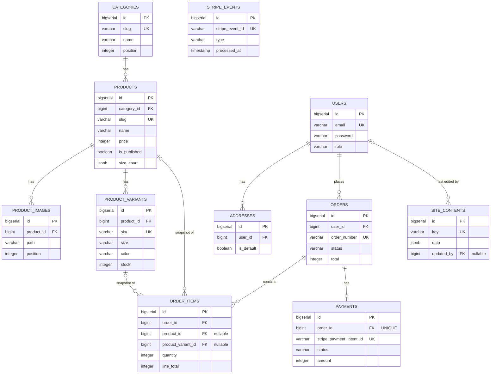

# データベース設計（PostgreSQL 16）

前回（EC-Portfolio2）から機能スコープは変更なし。テーブル定義・制約はそのまま踏襲する。

## ER概要



性別区別なし・ユニセックス。サイズは`S` `M` `L`（アクセサリーは`FREE`単一variant）。

Laravel標準テーブル（`users`, `password_reset_tokens`, `sessions`, `cache`, `jobs`, `failed_jobs`, `personal_access_tokens`）はそのまま利用。`jobs` / `failed_jobs`はキューで実際に使う。`sessions`は今回のセッション認証（`SESSION_DRIVER=database`）で実際に使う（[docs/backend/auth.md](./auth.md)）。`personal_access_tokens`はSanctumインストールの標準物として残るが、ブラウザ認証では空のまま運用される（将来の非ブラウザAPIクライアント用に予約）。

---

## マイグレーションのファイル名順

Laravelはマイグレーションをファイル名の辞書順で流す。`create_product_images_table`（`_i`）は`create_products_table`（`_s`）より前にソートされ、FK作成で落ちる。**タイムスタンプを手で調整**して依存順（親テーブル→子テーブル）を保証する（`role`は`create_users_table`に最初から入れる）:

```
0001_01_01_000000        create_users_table            (標準 + role)
0001_01_01_000001        create_cache_table            (標準)
0001_01_01_000002        create_jobs_table             (標準。failed_jobs含む)
2026_xx_xx_xxxxxx        create_personal_access_tokens_table  (install:api)
2026_xx_xx_xxxxxx        create_categories_table
2026_xx_xx_xxxxxx        create_products_table
2026_xx_xx_xxxxxx        create_product_images_table
2026_xx_xx_xxxxxx        create_product_variants_table
2026_xx_xx_xxxxxx        create_addresses_table
2026_xx_xx_xxxxxx        create_orders_table
2026_xx_xx_xxxxxx        create_order_items_table
2026_xx_xx_xxxxxx        create_payments_table
2026_xx_xx_xxxxxx        create_stripe_events_table
2026_xx_xx_xxxxxx        create_site_contents_table
```

---

## categories

| カラム | 型 | 制約 / 備考 |
|---|---|---|
| id | bigserial | PK |
| name | varchar(50) | `Tops`など |
| slug | varchar(50) | UNIQUE |
| position | integer | 表示順 |
| created_at / updated_at | timestamp | |

初期4件（`CategorySeeder`。position順）: `tops` / `bottoms` / `outerwear` / `accessories`。URLは`/collections/{slug}`（ルート自体は作らないがslugは保持）。

---

## products

| カラム | 型 | 制約 / 備考 |
|---|---|---|
| id | bigserial | PK |
| category_id | bigint | FK → categories、ON DELETE RESTRICT |
| name | varchar(120) | |
| slug | varchar(140) | UNIQUE |
| price | integer | JPY税込。CHECK (price > 0) |
| description | text | 商品説明（段落） |
| material | text | 素材 |
| care | text | nullable。取扱い・洗濯表示 |
| origin | varchar(50) | 原産国 |
| product_code | varchar(30) | 品番（表示用、variantのskuとは別） |
| size_chart | jsonb | nullable |
| is_published | boolean | default true。falseは公開一覧・詳細・APIから除外 |
| position | integer | 一覧の並び順 |
| created_at / updated_at | timestamp | |

インデックス: `category_id`, `slug`, `(is_published, position)`

### size_chart JSONフォーマット

```json
{
  "unit": "cm",
  "columns": ["着丈", "身幅", "肩幅", "袖丈"],
  "rows": { "S": [66, 52, 46, 20], "M": [68, 55, 48, 21], "L": [70, 58, 50, 22] }
}
```

Bottomsのcolumns例: `["ウエスト", "股上", "股下", "わたり幅", "裾幅"]`。Accessoriesは`size_chart = null`。

---

## product_images

| カラム | 型 | 制約 / 備考 |
|---|---|---|
| id | bigserial | PK |
| product_id | bigint | FK → products、ON DELETE CASCADE |
| path | varchar(255) | バケットのオブジェクトキー。例`products/12/01J....jpg` |
| alt | varchar(255) | |
| position | integer | 0=主画像、1=一覧ホバー画像、以降ギャラリー順 |
| created_at / updated_at | timestamp | |

インデックス: `(product_id, position)`。APIリソースが`url = /media/{path}`を組み立てて返す（`url`カラムは持たない）。

---

## product_variants

| カラム | 型 | 制約 / 備考 |
|---|---|---|
| id | bigserial | PK |
| product_id | bigint | FK → products、ON DELETE CASCADE |
| size | varchar(10) | `S` `M` `L` / `FREE` |
| color | varchar(30) | nullable |
| sku | varchar(40) | UNIQUE |
| stock | integer | CHECK (stock >= 0) |
| position | integer | サイズ表示順 |
| created_at / updated_at | timestamp | |

一意制約: NULL複合UNIQUEの罠を避けるため**2本立て**:
- 部分UNIQUEインデックス `UNIQUE(product_id, size, color) WHERE color IS NOT NULL`
- 部分UNIQUEインデックス `UNIQUE(product_id, size) WHERE color IS NULL`

### 在庫ステータス（API算出、閾値はconfig）

| 条件 | value | セレクタ |
|---|---|---|
| `stock = 0` | `sold_out` | 選択不可・グレーアウト |
| `1 <= stock <= 5` | `low_stock` | 選択可・`LOW STOCK` |
| `stock >= 6` | `in_stock` | 選択可 |

`config('shop.low_stock_threshold')`（= 5）。公開APIは生の`stock`を返さない。

---

## users（Laravel標準を拡張）

| カラム | 型 | 備考 |
|---|---|---|
| id | bigserial | PK |
| name | varchar(255) | 氏名 |
| email | varchar(255) | UNIQUE |
| password | varchar(255) | bcrypt |
| role | varchar(20) | `customer` / `admin`、default `customer` |
| remember_token | varchar(100) | |
| created_at / updated_at | timestamp | |

`email_verified_at`は無い（メール認証は実装しない）。シーダーで管理者1人（`role = 'admin'`。値は`ADMIN_*`）。

---

## addresses

| カラム | 型 | 制約 / 備考 |
|---|---|---|
| id | bigserial | PK |
| user_id | bigint | FK → users、ON DELETE CASCADE |
| recipient_name | varchar(100) | |
| postal_code | varchar(8) | `123-4567` |
| prefecture | varchar(10) | |
| city | varchar(100) | |
| address_line1 | varchar(255) | |
| address_line2 | varchar(255) | nullable |
| phone | varchar(20) | |
| is_default | boolean | default false。ユーザーごと最大1件true（Actionで担保 + 部分UNIQUEでDBも保証） |
| created_at / updated_at | timestamp | |

インデックス: `user_id`、部分UNIQUE `addresses_one_default_per_user ON (user_id) WHERE is_default`。Actionは「先に他をfalse→対象をtrue」の順で更新する（逆順だと一瞬2件になり違反）。

---

## orders

| カラム | 型 | 制約 / 備考 |
|---|---|---|
| id | bigserial | PK |
| user_id | bigint | FK → users、ON DELETE RESTRICT |
| order_number | varchar(20) | UNIQUE。`EC-YYYYMMDD-NNNN`（日付内連番）。**日付はJST** |
| status | varchar(20) | CHECK IN (`pending`,`paid`,`shipped`,`completed`,`cancelled`) |
| subtotal | integer | 明細合計 |
| shipping_fee | integer | 送料（¥800または0） |
| total | integer | subtotal + shipping_fee |
| paid_at | timestamp | nullable。決済成功時刻 |
| shipped_at | timestamp | nullable。発送時刻 |
| cancelled_at | timestamp | nullable。キャンセル時刻 |
| ship_recipient_name | varchar(100) | 配送先スナップショット |
| ship_postal_code | varchar(8) | |
| ship_prefecture | varchar(10) | |
| ship_city | varchar(100) | |
| ship_address_line1 | varchar(255) | |
| ship_address_line2 | varchar(255) | nullable |
| ship_phone | varchar(20) | |
| created_at / updated_at | timestamp | |

住所は注文時点の値をコピー保持。インデックス: `user_id`, `order_number`, `(status, paid_at)`（運用ダッシュボードの未発送注文を`paid_at`の古い順に取得する用）。

タイムゾーン: アプリ（`config/app.php`）もDBも**UTCで保存**する。日本時間が必要な所（注文番号の日付）だけ、計算時に`Asia/Tokyo`に変換する。

### 注文ステータスstate machine

```
          POST /api/orders
                │
                ▼
            ┌────────┐   payment_intent.succeeded (Webhook)   ┌──────┐
            │ pending │ ─────────────────────────────────────▶ │ paid │
            └────────┘                                         └──────┘
                │                                                  │ admin: 発送
                │ 放棄(TTL) / 置き換え / adminキャンセル              ▼
                │                                              ┌─────────┐
                │                                              │ shipped │
                ▼                                              └─────────┘
           ┌───────────┐                                            │ admin: 完了
           │ cancelled │ ◀── admin: paidからのキャンセル(返金)        ▼
           └───────────┘                                       ┌───────────┐
           （在庫を戻す）                                        │ completed │
                                                               └───────────┘
```

許可される遷移（`OrderStatus::canTransitionTo()`）:

| from → to | 実行者 | 副作用 |
|---|---|---|
| `pending → paid` | Stripe Webhook | `paid_at`セット、注文確認メールdispatch |
| `pending → cancelled` | 期限切れ（scheduler）/ 新しい注文での置き換え / Webhook `payment_intent.canceled` / admin | `cancelled_at`セット、在庫復元、PaymentIntentをStripeで取り消し。決済失敗（`payment_failed`）ではcancelledにしない（pendingのまま再試行できる） |
| `paid → shipped` | admin | `shipped_at`セット、発送通知メールdispatch |
| `paid → cancelled` | admin | `cancelled_at`セット、在庫復元、**Stripe返金** |
| `shipped → completed` | admin | — |
| `shipped → cancelled` | admin | 返品扱い。**手動対応前提**。在庫は戻さない（`cancelled_at`のみ） |

それ以外の遷移は422（`InvalidOrderTransitionException`）。

---

## order_items

| カラム | 型 | 制約 / 備考 |
|---|---|---|
| id | bigserial | PK |
| order_id | bigint | FK → orders、ON DELETE CASCADE |
| product_id | bigint | FK → products、ON DELETE SET NULL（nullable） |
| product_variant_id | bigint | FK → product_variants、ON DELETE SET NULL（nullable） |
| product_name | varchar(120) | スナップショット |
| variant_size | varchar(10) | スナップショット |
| variant_color | varchar(30) | nullable。スナップショット |
| image_url | varchar(255) | 主画像スナップショット。画像なしは空文字（NOT NULL） |
| unit_price | integer | 注文時単価 |
| quantity | integer | CHECK (quantity > 0) |
| line_total | integer | unit_price * quantity |
| created_at / updated_at | timestamp | |

インデックス: `order_id`（PostgreSQLはFKに自動でインデックスを張らないため。注文明細の取得で使う）。

---

## payments

Stripe PaymentIntentを注文と1:1で記録する。

| カラム | 型 | 制約 / 備考 |
|---|---|---|
| id | bigserial | PK |
| order_id | bigint | FK → orders、ON DELETE CASCADE、UNIQUE |
| provider | varchar(20) | 固定`stripe`（将来の拡張余地） |
| stripe_payment_intent_id | varchar(255) | UNIQUE。`pi_...` |
| status | varchar(30) | `requires_payment_method` / `processing` / `succeeded` / `canceled`などStripeの値をそのまま |
| amount | integer | PaymentIntent作成時の金額（= orders.total。JPYなので最小単位＝円） |
| currency | varchar(3) | 固定`jpy` |
| stripe_charge_id | varchar(255) | nullable。成功後に格納（返金用） |
| refunded_at | timestamp | nullable |
| last_error | varchar(255) | nullable。直近の決済失敗理由（表示用） |
| created_at / updated_at | timestamp | |

PaymentIntentは注文ごとに1つ。再試行しても同じ`payment_intent_id`を使い回す（[docs/backend/payments.md](./payments.md)）。`amount`は監査用の記録。実際の請求額はStripe側が正。

---

## stripe_events

Webhookの冪等性をDBで保証するための処理済みイベント台帳。

| カラム | 型 | 制約 / 備考 |
|---|---|---|
| id | bigserial | PK |
| stripe_event_id | varchar(255) | UNIQUE。`evt_...` |
| type | varchar(80) | `payment_intent.succeeded`など |
| processed_at | timestamp | 処理完了時刻 |
| created_at | timestamp | 受信時刻 |

Webhook受信時にまず`stripe_event_id`をUNIQUE制約付きでINSERT。既存なら「処理済み」として200を返し何もしない。

---

## site_contents（CMS）

トップページの編集可能コンテンツ。詳細は [docs/backend/cms.md](./cms.md)。

| カラム | 型 | 制約 / 備考 |
|---|---|---|
| id | bigserial | PK |
| key | varchar(40) | UNIQUE。`hero` / `concept` / `lookbook` / `about` |
| data | jsonb | セクションごとのスキーマ |
| updated_by | bigint | nullable。FK → users（ON DELETE SET NULL）。最後に編集したadmin |
| created_at / updated_at | timestamp | |

`SiteContentSeeder`で4キーを初期投入。

---

## 注文作成トランザクション（`POST /api/orders`）

決済は**この後**の別ステップ。

1. カート明細（`variant_id` + `quantity`の配列）と`address`（既存id or新規オブジェクト）を受け取る
2. トランザクション開始
3. 対象variantを`FOR UPDATE`でロックし、`stock >= quantity`を検証。不足あれば422で該当明細を返却しロールバック
   - **ロックは必ず`id`昇順で取る**（`orderBy('id')->lockForUpdate()`）。順番が揃っていないと、Aが[1, 2]・Bが[2, 1]を同時に注文したときに互いのロックを待ち合うデッドロックになりうる
4. `is_published = false`の商品が含まれれば422
5. `subtotal`を再計算（クライアント送信の金額は信用しない）、送料ルール適用
6. `order_number`採番（`EC-{today}-{当日連番}`。`today`は`now('Asia/Tokyo')`の日付）
7. `orders`（`status = pending`）/ `order_items`を作成、各variantの`stock`を減算
8. 新規住所かつ「保存」指定なら`addresses`にも作成
9. コミット、作成したorderを返却

## 決済トランザクション（Webhook `payment_intent.succeeded`）

[docs/backend/payments.md](./payments.md) に詳細。要点:

1. 署名検証 → `stripe_events`にevent idをINSERT（重複なら即200）
2. metadataの`order_id`で注文を取得。行ロック
3. `status !== 'pending'`ならno-op（冪等）
4. `payments.status = succeeded` / `orders.status = paid` / `orders.paid_at = now()`を更新
5. `SendOrderConfirmationJob`をdispatch
6. `stripe_events.processed_at`を更新、コミット、200
</content>
